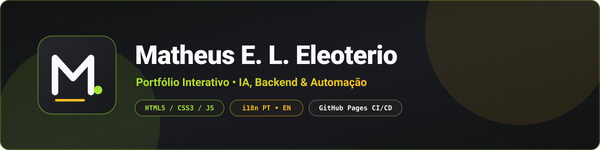
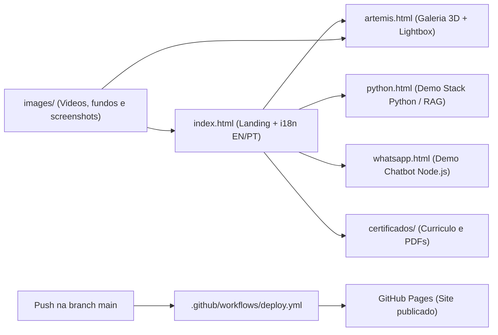

<div align="center">



<p>
  <a href="https://matheusele.github.io/portfolio/" target="_blank">
    
  </a>
  
  <a href=".github/workflows/deploy.yml">
    
  </a>
  <a href="LICENSE">
    
  </a>
</p>

**Portfólio pessoal interativo para apresentação de projetos em IA, Backend e Automação — sem frameworks pesados ou etapa de build.**  
Landing page estática bilíngue (EN/PT), mosaicos 3D animados, simulações interativas no navegador e deploy contínuo via GitHub Pages.

[Por que usar](#-por-que-usar) •
[Fluxo e arquitetura](#-fluxo-e-arquitetura) •
[Funcionalidades e páginas](#-funcionalidades-e-páginas) •
[Estrutura](#-estrutura) •
[Instalação e uso](#-instalação-e-uso) •
[Validação e roadmap](#-validação-e-roadmap)

</div>

---

## 🎯 Por que usar

O site reúne trajetória acadêmica e profissional, stack técnica, certificados em PDF, currículo e demonstrações práticas de projetos em uma interface direta, leve e responsiva.

- **Mosaicos 3D animados em CSS puro:** A seção *About Me* ([`index.html`](index.html)) exibe um mosaico 3D em colunas alternadas com as tecnologias da stack ao lado do avatar, enquanto a galeria do projeto Artemis 2.0 ([`artemis.html`](artemis.html)) alterna suavemente entre parede 3D inclinada e grade com *lightbox*.
- **Demos interativas executáveis no navegador:** Páginas dedicadas simulam ao vivo a execução da stack Python/RAG ([`python.html`](python.html)) e o fluxo de atendimento de um chatbot estilo WhatsApp Web ([`whatsapp.html`](whatsapp.html)).
- **Experiência completa sem dependências de build:** Alternância dinâmica de idioma (**EN / PT**) via JavaScript, cursor customizado, canvas de partículas no Hero, visualizador modal de currículo e acesso direto aos certificados em PDF em `certificados/`.

<div align="center">
  
</div>

---

## 🔄 Fluxo e arquitetura



---

## ⚡ Funcionalidades e páginas

| Item / Página | Ícone | O que faz | Entrada / Saída |
|---|:---:|---|---|
| [`index.html`](index.html) | 🌐 | Landing page principal com Hero em vídeo/partículas, *About Me* com mosaico 3D de tecnologias, certificados, projetos e currículo | Toggle `EN / PT` e modais → Visualização e downloads em PDF |
| [`artemis.html`](artemis.html) | 🖼️ | Galeria do **Artemis 2.0** com parede em mosaico 3D animado, alternância fluida para grade e modal *lightbox* com navegação por teclado | Clique nas janelas / botão de vista → Preview ampliado (`5` telas reais) |
| [`python.html`](python.html) | 🐍 | Demonstração interativa de arquitetura Python (FastAPI, RAG, LangChain e automação) em interface estilo chat | Seleção de comandos no menu → Respostas simuladas em tempo real |
| [`whatsapp.html`](whatsapp.html) | 💬 | Simulação interativa de chatbot Node.js em interface inspirada no WhatsApp Web | Interação no chat → Fluxo de respostas automatizadas |
| [`certificados/`](certificados) | 📄 | Repositório local de currículo (`Modern Minimalist CV Resume.pdf`) e 6 certificados | Abertura no navegador ou download direto via `index.html` |
| [`.github/workflows/deploy.yml`](.github/workflows/deploy.yml) | 🚀 | Pipeline oficial de publicação automática no GitHub Pages a cada push na `main` | Evento `push` (`main`) ou `workflow_dispatch` → Deploy estático |

---

## 🗂️ Estrutura

<details open>
<summary><b>Árvore de diretórios do projeto</b></summary>

```text
portfolio/
├── .agents/
│   └── AGENTS.md                # Contexto visual dos cards e galeria
├── .github/
│   └── workflows/
│       └── deploy.yml           # Deploy automático para GitHub Pages
├── assets/
│   ├── banner.svg               # Banner principal do README
│   ├── demo.svg                 # Demonstração animada em terminal SVG
│   └── logo.svg                 # Monograma vetorial M.
├── certificados/                # Currículo e 6 certificados em PDF
├── images/                      # Vídeos MP4, fundos, perfil PNG, QR codes e capturas Artemis
├── artemis.html                 # Galeria 3D + grade do projeto Artemis 2.0
├── index.html                   # Landing page principal (HTML, CSS e JS + i18n)
├── LICENSE                      # Licença MIT
├── python.html                  # Demo interativa da stack Python
├── README.md                    # Documentação do repositório
└── whatsapp.html                # Demo interativa estilo WhatsApp Web
```

</details>

---

## 🚀 Instalação e uso

<details open>
<summary><b>Pré-requisitos e execução local</b></summary>

Não há dependências de pacotes (`npm`, `pip`) nem etapa de compilação. Basta qualquer navegador moderno ou um servidor HTTP estático local:

```bash
git clone https://github.com/MATHEUSele/portfolio.git
cd portfolio
python -m http.server 8000
```

Em seguida, acesse `http://localhost:8000/` no navegador (ou abra [`index.html`](index.html) diretamente).

</details>

<details>
<summary><b>Deploy contínuo (GitHub Pages)</b></summary>

O workflow [`.github/workflows/deploy.yml`](.github/workflows/deploy.yml) publica toda a raiz do repositório (`.`) automaticamente no GitHub Pages quando há um `push` na branch `main` (ou execução manual via `workflow_dispatch`):

```bash
git push origin main
```

</details>

---

## 🛠️ Validação e roadmap

- **Checks automatizados:** Pipeline [`deploy.yml`](.github/workflows/deploy.yml) ativo no GitHub Actions para publicação contínua em `https://matheusele.github.io/portfolio/`, além de validação de bem-formação XML nos SVGs de [`assets/`](assets/banner.svg).
- **Próximos passos:** Aplicar efeitos visuais de destaque na vitrine de certificados em [`index.html`](index.html) e manter novas demos interativas alinhadas à identidade Grafite + Verde-limão.

<div align="center">
  
  <br />
  <sub>Desenvolvido por Matheus E. L. Eleoterio • Licença <a href="LICENSE">MIT</a></sub>
</div>
